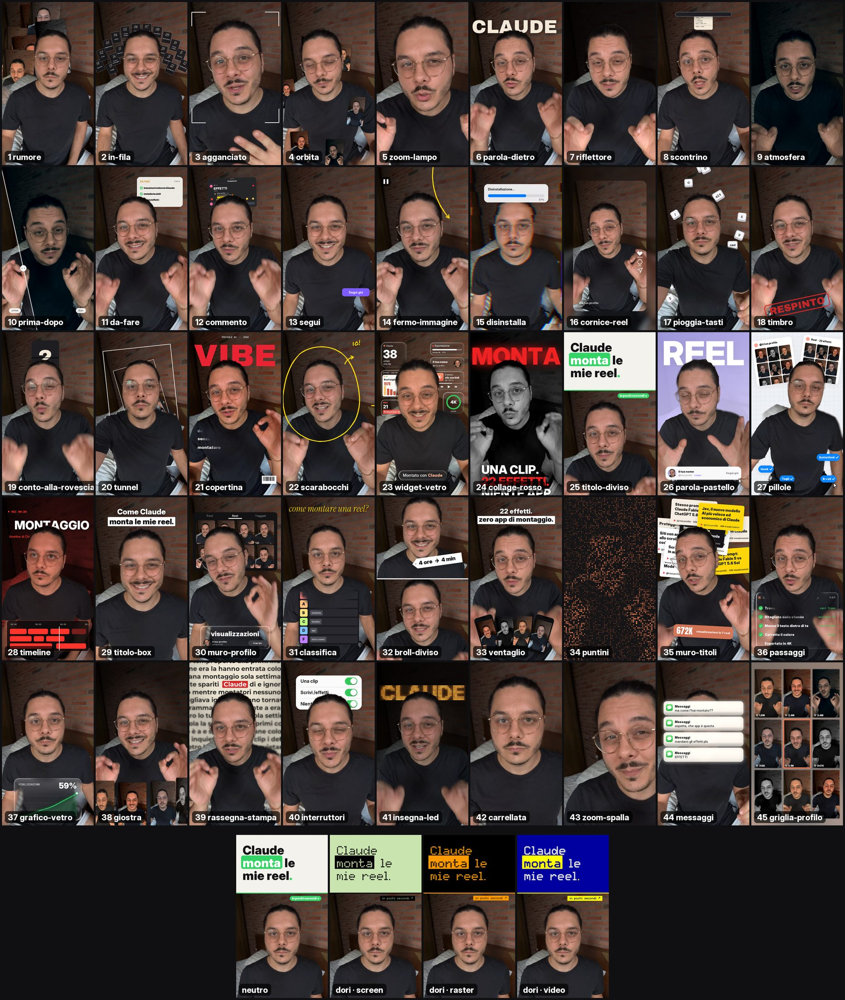

# 45 effetti video per Claude, in italiano

Trascini il video in Claude, scrivi `/effetti` e il nome dell'effetto, e non devi fare altro.



*Sotto la griglia c'è `titolo-diviso` col tema neutro e con le tre varianti video del tema `dori`.*

È la versione italiana di [claude-video-effects](https://github.com/Vibha-Ramprakash/claude-video-effects) di [Vibha Ramprakash](https://instagram.com/vibha.in.progress). Gli effetti sono gli stessi 45 e col tema neutro escono identici ai suoi, pixel per pixel. Rispetto all'originale cambia questo:

- È in italiano: i nomi (`orbita`, `riflettore`, `scontrino`), le opzioni e i testi che compaiono nel video, come "Segui già" o "Aggiungi un commento...". I nomi inglesi funzionano ancora.
- Gli effetti prendono colori, caratteri e angoli da un design system, anche da quello che hai fatto con Claude. Senza tema hanno il look originale.
- Sul Mac il viso e il ritaglio della persona li trova Apple Vision, che taglia meglio capelli e occhiali. Su Windows e Linux si usa MediaPipe, come nell'originale.

## Installazione

Apri il Terminale (o il terminale dentro Claude Code) e incolla:

```bash
git clone https://github.com/andreadorizza/effetti-video ~/.claude/skills/effetti
```

Su Windows (PowerShell) scrivi `$HOME\.claude\skills\effetti` al posto di `~/.claude/skills/effetti`.

Poi riavvia Claude Code.

> Non sai come si fa? Apri Claude Code e scrivi: **"Installa la skill da github.com/andreadorizza/effetti-video in ~/.claude/skills/effetti"**. Ci pensa Claude.

Per aggiornarla: `git -C ~/.claude/skills/effetti pull`.

## Come si usa

1. Apri Claude Code (l'app o il terminale).
2. Trascina il video nella chat.
3. Scrivi l'effetto che vuoi:

```
/effetti orbita dal secondo 3 al 6
/effetti riflettore quando dico "spegni le luci", con la parola CLAUDE dietro di me
/effetti commento alla fine, che scrive GUIDA
/effetti widget-vetro per i primi 3 secondi
```

La prima volta Claude prepara tutto da solo, in un paio di minuti. Servono `ffmpeg` e Python, e se mancano li installa lui.

Prima guarda qualche fotogramma e sposta quello che ti coprirebbe la faccia, poi crea `tuovideo_effetti.mp4` accanto all'originale. L'audio resta quello.

Puoi chiedere più effetti in una volta: *"agganciato dal 6 al 10, poi orbita dal 10 al 13, poi un timbro quando dico 'no'"*.

## I 45 effetti

| # | Scrivi | Cosa succede |
|---|---|---|
| 1 | `rumore` | Le tue reel si accumulano dietro la testa |
| 2 | `in-fila` | Tessere numerate si aprono ad arco sopra la testa |
| 3 | `agganciato` | Quattro angoli si agganciano al viso e la camera ti segue |
| 4 | `orbita` | Le tue reel ti girano intorno alla testa, dietro di te in alto |
| 5 | `zoom-lampo` | Uno zoom veloce su una parola |
| 6 | `parola-dietro` | Una parola gigante cade dietro di te |
| 7 | `riflettore` | Si spengono le luci, resti illuminato solo tu |
| 8 | `scontrino` | Le tue istruzioni escono stampate come uno scontrino |
| 9 | `atmosfera` | Una correzione colore cupa |
| 10 | `prima-dopo` | Un cursore prima/dopo |
| 11 | `da-fare` | Una lista accanto alla testa che si spunta mentre parli |
| 12 | `commento` | Un commento di Instagram si scrive da solo e viene pubblicato |
| 13 | `segui` | Un pulsante Segui diventa Segui già |
| 14 | `fermo-immagine` | Fermo immagine con una freccia disegnata a mano |
| 15 | `disinstalla` | Una barra di disinstallazione glitchata spacca l'immagine |
| 16 | `cornice-reel` | Il video si rimpicciolisce dentro una scheda reel |
| 17 | `pioggia-tasti` | Tasti della tastiera piovono dietro di te |
| 18 | `timbro` | Un grosso timbro cala sullo schermo |
| 19 | `conto-alla-rovescia` | Un orologio a palette con 3, 2, 1 sopra la testa |
| 20 | `tunnel` | La stanza sprofonda in un tunnel dietro di te |
| 21 | `copertina` | Diventi la copertina di una rivista |
| 22 | `scarabocchi` | Scarabocchi a pennarello si disegnano da soli intorno a te |
| 23 | `widget-vetro` | Widget di vetro e mini artefatti fluttuano intorno alla testa |
| 24 | `collage-rosso` | Tu in bianco e nero, una parola rossa gigante dietro, tre righe che entrano di colpo |
| 25 | `titolo-diviso` | Una scheda col titolo scende e ti spinge nella metà bassa |
| 26 | `parola-pastello` | Stanza lilla, parola gigante dietro di te, una scheda profilo riceve un Segui |
| 27 | `pillole` | Stanza a quadretti, le tue reel appese dietro di te, un cursore clicca le pillole |
| 28 | `timeline` | Look da film rosso scuro con una timeline di montaggio e una testina luminosa |
| 29 | `titolo-box` | Uno zoom con un titolo pulito su due righe |
| 30 | `muro-profilo` | La griglia delle tue reel riempie il muro mentre un contatore sale |
| 31 | `classifica` | Arriva una tier list e Claude vola in fascia S |
| 32 | `broll-diviso` | B-roll sopra con un'etichetta prezzo, tu sotto |
| 33 | `ventaglio` | Le tue reel si aprono come una mano di telefoni |
| 34 | `puntini` | L'inquadratura si compone di puntini luminosi, poi torna nitida |
| 35 | `muro-titoli` | I tuoi titoli si accumulano dietro la testa, poi davanti compare un totale |
| 36 | `passaggi` | Una lista di passaggi di Claude sotto il mento, ogni passo si spunta |
| 37 | `grafico-vetro` | Una scheda di vetro liquido con un grafico che sale e un numero che conta |
| 38 | `giostra` | Le tue reel ti girano intorno in una giostra 3D |
| 39 | `rassegna-stampa` | Pagine di giornale che cambiano su una parola, ferma dietro la testa |
| 40 | `interruttori` | Gli interruttori dell'iPhone si accendono, una riga alla volta |
| 41 | `insegna-led` | Le luci calano e un'insegna LED si scrive da sola dietro di te |
| 42 | `carrellata` | Una lenta spinta sul viso mentre la stanza va fuori fuoco |
| 43 | `zoom-spalla` | La camera entra in un angolo e accanto alla testa compare un grafico di vetro, poi l'altro angolo |
| 44 | `messaggi` | Notifiche di iMessage compaiono una dopo l'altra con un leggero bagliore |
| 45 | `griglia-profilo` | Ti rimpicciolisci al centro della tua griglia 3x3 e le reel compaiono intorno con le visualizzazioni |

Stili in più: `/effetti riflettore-glitter` (raggi dorati e scintille), `copertina stile=editoriale` (una copertina classica) e `grafico-vetro stile=bento` (un pannello di vetro intorno a te).

Gli effetti seguono il tuo viso, e quello che ti coprirebbe la faccia finisce dietro la testa. Anche i nomi inglesi dell'originale funzionano (`/effetti orbit` è `/effetti orbita`); l'elenco completo, con le opzioni, è in [SKILL.md](SKILL.md).

**Consigli**
- Funzionano meglio i video verticali dal telefono, con te nell'inquadratura.
- I tempi dilli a parole ("quando dico 'guarda'"). Claude trova il secondo esatto.
- Vuoi le tue reel in `orbita`, `rumore`, `ventaglio` o `muro-profilo`? Dai a Claude una cartella di screenshot.
- Grafici, contatori e titoli devono avere i tuoi numeri veri. Digli quali sono.
- Esce in 1080p. Se vuoi il 4K chiedilo (ci mette di più).

## I tuoi colori

Con un tema gli effetti prendono i colori, i caratteri e gli angoli del tuo brand. L'arancione di Claude diventa il tuo colore di accento, per esempio, e se il tuo stile è piatto il vetro e le ombre spariscono.

Se hai un design system fatto con Claude, dai il link a Claude e scrivi: *"usa il mio design system per gli effetti"*. Lui legge colori e caratteri e li salva come tema. Va bene anche il solo file `tokens.json`.

```
/effetti da-fare dal 2 al 6, col tema dori
```

Come funziona e come si scrive un tema a mano: [docs/design-system.md](docs/design-system.md). C'è un esempio completo, `temi/dori`, il mio design system. Ha quattro varianti: `screen` (verde LCD), `raster` (ambra CRT), `video` (blu televideo) e `paper`.

## Aggiungere effetti

Ogni effetto è un file in `effetti/fx/`, e se aggiungi un file hai un effetto in più. Come si scrive: [docs/nuovo-effetto.md](docs/nuovo-effetto.md). Ne aggiungerò altri quando ne trovo di belli.

## Note oneste

- Sono versioni di partenza, e non verranno uguali alla reel che hai visto, che ha anche i suoni e i tempi sistemati a mano.
- Claude fa la bozza e tu approvi. Guarda il video prima di pubblicarlo.
- Suoni e sottotitoli non li aggiunge. Per quelli c'è CapCut.

## Se qualcosa non va

Di' a Claude cosa vedi ("la scritta mi copre la faccia", "è troppo veloce"). Lui corregge il piano e rifà il video.

## Crediti

- **Effetti e motore:** [claude-video-effects](https://github.com/Vibha-Ramprakash/claude-video-effects) di Vibha Ramprakash, licenza MIT. I 45 effetti sono suoi. Qui sono stati divisi in un file per effetto, tradotti e collegati al tema. `tests/confronto.py` controlla che col tema neutro e i testi in inglese disegnino ancora esattamente come i suoi.
- **Tracciamento:** [OpenCV YuNet](https://github.com/opencv/opencv_zoo) (MIT) per il viso, [MediaPipe Selfie Segmenter](https://ai.google.dev/edge/mediapipe/solutions/vision/image_segmenter) (Apache 2.0) per il ritaglio; sul Mac, Apple Vision.
- **Caratteri:** Archivo Black, Instrument Serif, Space Mono, Inter, Anton, Montserrat, Playfair Display (SIL OFL) e Permanent Marker (Apache 2.0). Nel tema `dori` ci sono Matrix Sans e Schibsted Grotesk (SIL OFL). Le licenze sono in `fonts/` e in `temi/dori/licenses/`.
- **Tutto il resto:** MIT, vedi `LICENSE`.
